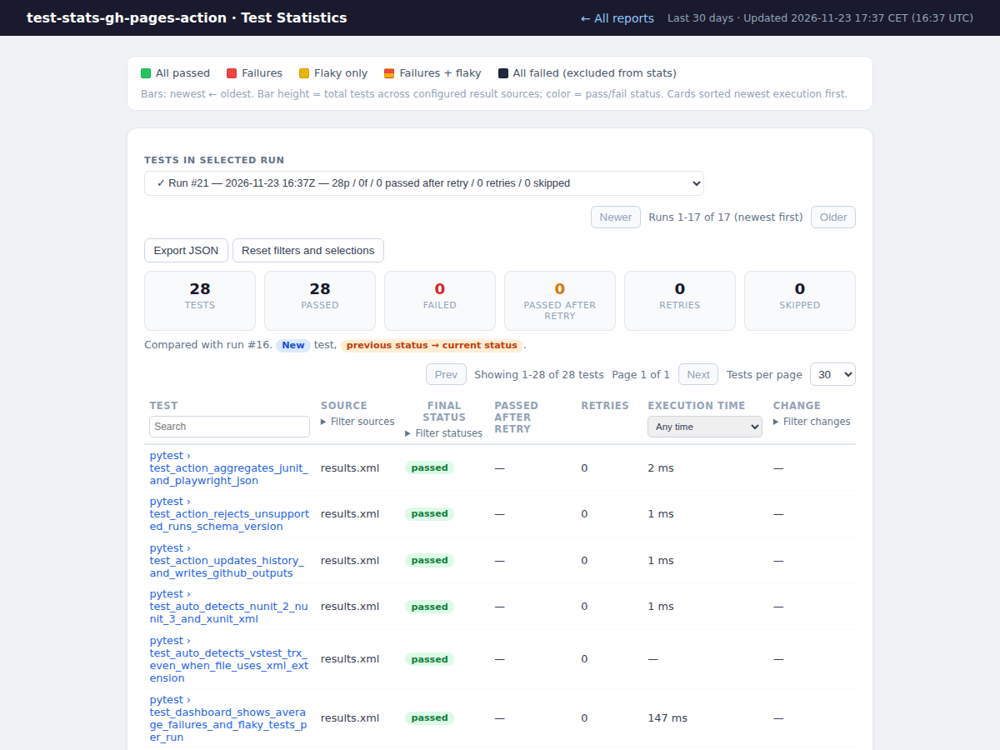
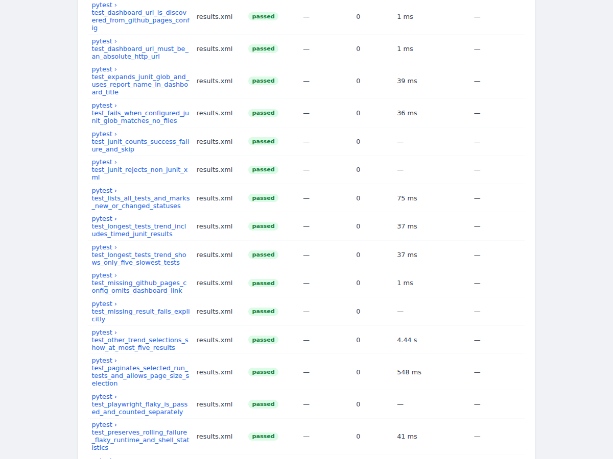
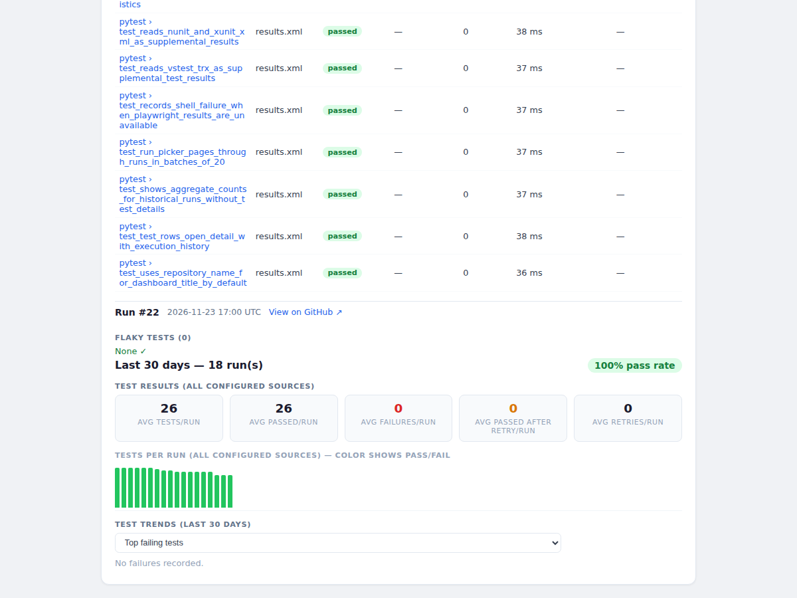

# Test statistics for GitHub Pages

[](https://raczeja.github.io/test-stats-gh-pages-action/stats/)

[Ask DeepWiki](https://deepwiki.com/raczeja/test-stats-gh-pages-action)

<!-- stats-dashboard-screenshots:start -->
[](https://raczeja.github.io/test-stats-gh-pages-action/stats/)
[](https://raczeja.github.io/test-stats-gh-pages-action/stats/)
[](https://raczeja.github.io/test-stats-gh-pages-action/stats/)
[](https://raczeja.github.io/test-stats-gh-pages-action/stats/)
[](https://raczeja.github.io/test-stats-gh-pages-action/stats/)
<!-- stats-dashboard-screenshots:end -->

Composite GitHub Action for parsing test-result files, writing a GitHub Actions
step summary, and updating a rolling test-statistics site in a caller-provided
directory. It does not deploy Pages; the caller can combine its output with
other site content and perform one deployment.

## Usage

```yaml
- name: Collect test statistics
  id: stats
  uses: raczeja/test-stats-gh-pages-action@v1
  with:
    result-files: |
      test-results/junit.xml
    format: auto
    site-directory: site
    stats-subdirectory: reusable-stats
    history-days: 30
    report-name: CI tests
    # Optional override; auto-detected from GitHub Pages configuration if omitted.
    # dashboard-url: https://owner.github.io/repo/stats/
    detailed-statistics: "true"
```

By default, the action looks up the repository's configured GitHub Pages URL
and links to its `stats/` dashboard in the GitHub Actions summary. The workflow
token needs `pages: read` permission for this lookup. If Pages is not configured
yet, the summary includes counts without a dashboard link. You can set
`dashboard-url` explicitly to override the discovered URL.

The action is test-runner agnostic when a runner can emit JUnit XML, a common
interchange format supported by many test frameworks. Built-in parsers support
JUnit XML, VSTest TRX, NUnit 2/3 XML, xUnit.net XML reports with an
`assemblies` root, and Playwright-format JSON
(`.json`, with `stats` and `suites` objects). `format: auto` selects JSON by
extension and distinguishes XML formats by their root element, even when a TRX
file has an `.xml` extension. To add another native format, implement a parser
adapter that emits the existing normalized counts and preserve
`stats/runs.json` as the storage contract.

For example, VSTest can write a TRX report using the supplied logger command
(the `.xml` filename is okay; the action detects the TRX contents):

```yaml
- name: Run VSTest
  shell: pwsh
  run: >-
    dotnet vstest .\Ocaramba.Tests.Features\bin\Release\Ocaramba.Tests.Features.dll
    /TestCaseFilter:"(TestCategory!=TakingScreenShots)" /Parallel
    /ResultsDirectory:TestResults
    /Logger:"trx;LogFileName=Ocaramba.Tests.Features.xml"

- name: Collect test statistics
  uses: raczeja/test-stats-gh-pages-action@v1
  with:
    result-files: TestResults/Ocaramba.Tests.Features.xml
    format: auto
    shell-test-results: TestResults/Ocaramba.Tests.Features.xml
    site-directory: site
```

The report path must match where VSTest writes the logger output. `result-files`
includes TRX counts in the action summary and run history; setting
`shell-test-results` also adds individual tests and failures to the detailed
dashboard.

The statistics action requires Python 3 on the runner. `result-files` accepts
newline-separated paths or glob patterns. Missing matches and malformed files
fail the action rather than producing success-shaped empty data.

It creates/updates:

- `<stats-subdirectory>/runs.json` — normalized run history, pruned to the
  configured rolling window and deduplicated by GitHub run number. The file
  records each run's branch from `GITHUB_HEAD_REF` when available (for pull
  requests), otherwise from `GITHUB_REF_NAME`; older runs without branch
  metadata remain available under
  **Unknown branch**. It includes `"schemaVersion": 1`; files from earlier
  releases without this field
  are treated as legacy schema version 1 and upgraded in place. Unsupported
  schema versions fail explicitly instead of risking a silent format mismatch.
- `<stats-subdirectory>/index.html` — a small static recent-run table including
  the branch for each run.
- `$GITHUB_STEP_SUMMARY` with test counts and a link to the published dashboard
  when its Pages URL is available; plus action outputs `total`, `passed`,
  `failed`, `skipped`, and `stats-file`.
- `stats/runs.json` and `stats/index.html` — the detailed rolling 30-day
  per-test dashboard, including average failures and flaky tests per run across
  eligible runs. It lists all tests captured by
  the selected run (the newest run by default), with a selector at the top of
  the dashboard. The **Branch** selector defaults to **All branches** and
  filters the run list, headline statistics, test trends, and run history; the
  selected branch is remembered with the other dashboard preferences. Switching
  branches selects that branch's latest run, and test changes are compared with
  the previous run on the same branch. The selected run lists each test's
  execution time when available. The Source column shows the imported result
  filename. The Test,
  Source, Status, Execution time, and Change columns can be
  sorted by clicking their headers. The default order puts failed tests first,
  then flaky tests, then new and changed tests, with test name as the tie-breaker.
  Headline statistics include all configured result sources, and the selected run
  shows available failure details from JSON and XML reports.
  Each test-table column has its filter in the column header: test-name search,
  available source/status/change checkboxes, and execution-time choices derived
  from that run's measured durations (fastest/slowest percentiles and whether
  timing data is available). Filters apply before sorting and pagination and
  refresh when another run is selected.
  The latest run is selected by default whenever the dashboard loads. The run
  selector shows at most 20 runs at a time, with Newer/Older controls to page
  through the remaining runs. Filters, pagination, sorting, and trend selection
  are remembered in a site-scoped cookie. A reset control clears saved
  preferences and restores defaults. The table is paginated with 30 tests per
  page by default, selectable sizes of 30, 50, or 100, Prev/Next controls, a
  displayed range,
  and a page count. It marks new tests and status changes against the previous
  run, and includes failures from each configured result source in the Top
  failing Test trends view. Selecting Top failing tests highlights every failed
  test in the selected run in yellow; the trend list remains limited to the top
  five across the history. Failures seen in only some runs are included in the
  Flaky tests trend. Clicking a test name opens its detail view with up to 20
  executions, a pass/fail timeline, failure messages, execution duration, retry
  count, first failure date, last successful execution, and links to the
  original GitHub Actions runs.
  Detailed statistics are enabled by default and can be disabled with
  `detailed-statistics: "false"`.

For Playwright-format JSON, retry successes count as passed and are reported
separately as passed after retry. The detailed dashboard records each test's
final status and retry count, and reports total retries separately from the
number of tests that passed after retry.
JUnit XML, VSTest TRX, NUnit 2/3 XML, and xUnit.net XML results contribute to
the normalized results and summary. The detailed dashboard can include
Playwright-format JSON and optional JUnit, VSTest, NUnit, or xUnit XML reports;
`shell-test-results` accepts a file path or glob pattern for these formats.
The detailed dashboard title uses the repository name by default; optional
`report-name` text is appended to it.
For example, `DBTestCompare` with `report-name: Test results` displays
“DBTestCompare · Test results · Test Statistics.” The GitHub Actions summary
continues to use “Test results” when `report-name` is omitted.

## Permissions and deployment

The action itself uses only local files and does not request a token or modify a
branch. Set the workflow's `contents: write` permission only on the separate
deployment job that publishes the assembled site. Pin the action to a reviewed
release tag or commit SHA.

## Set up GitHub Pages in your project

Add a workflow to your project that runs your tests, generates a result file,
updates the site with this action, and publishes the `site` directory:

```yaml
name: Test report

on:
  push:
    branches: [main]
  workflow_dispatch:

# Serialize the complete read-update-publish cycle for this repository.
concurrency:
  group: gh-pages-${{ github.repository }}
  cancel-in-progress: false

permissions:
  contents: read
  pages: read

jobs:
  build:
    runs-on: ubuntu-latest
    steps:
      - uses: actions/checkout@v4

      - name: Restore the existing Pages site
        shell: bash
        run: |
          mkdir -p site
          if git ls-remote --exit-code --heads origin gh-pages >/dev/null; then
            git fetch --no-tags origin gh-pages
            git archive FETCH_HEAD | tar -x -C site
          else
            status=$?
            if [ "$status" -eq 2 ]; then
              echo "No gh-pages branch exists yet; starting a new site."
            else
              exit "$status"
            fi
          fi

      - name: Run tests
        run: ./scripts/run-tests.sh # Configure your runner to write JUnit XML.

      - name: Update test statistics
        uses: raczeja/test-stats-gh-pages-action@v1
        with:
          result-files: test-results/junit.xml
          site-directory: site
          shell-test-results: test-results/junit.xml

      - uses: actions/upload-artifact@v4
        with:
          name: pages-site
          path: site

  publish:
    needs: build
    runs-on: ubuntu-latest
    permissions:
      contents: write
    steps:
      - uses: actions/download-artifact@v4
        with:
          name: pages-site
          path: site

      - name: Publish site
        uses: peaceiris/actions-gh-pages@v4
        with:
          github_token: ${{ secrets.GITHUB_TOKEN }}
          publish_dir: site
          force_orphan: true
```

Replace the test command and `result-files` path with the ones used by your
project. The first workflow run can create the `gh-pages` branch when it
publishes, so you do not need to create the branch manually. After that run
succeeds, open **Settings → Pages**, choose **Deploy from a branch**, then
select `gh-pages` and the root (`/`) folder.

The workflow-level `concurrency` group serializes the whole read-update-publish
cycle, so each run restores the site after the previous run has finished
publishing. If another workflow in the same repository also publishes to
`gh-pages`, give it the same group name. Do not put this group only on the
`publish` job: the site may already have been read by `build` before that job
waits. With `cancel-in-progress: false`, a running workflow is not cancelled,
but GitHub Actions keeps only one pending run per group; a newer run can replace
an older pending run. If every test run must be recorded, use a durable queue or
retry the update against the latest `gh-pages` content rather than relying on
concurrency alone.

With `force_orphan: true`, each deployment replaces the `gh-pages` branch with
a new root commit. **The branch's previous commit history is not kept.** The
source branch (for example, `main`) is unaffected.

## Enable GitHub Pages and deploy from `gh-pages`

The workflow above can create the `gh-pages` branch on its first successful
deployment. If you prefer to create it yourself first, initialize an empty
branch. For example, from a temporary directory (replace `OWNER/REPO` with
your repository):

```sh
mkdir gh-pages-init
cd gh-pages-init
git init -b gh-pages
touch .nojekyll
git add .nojekyll
git -c user.name="GitHub Actions" \
    -c user.email="github-actions[bot]@users.noreply.github.com" \
    commit -m "Initialize Pages branch"
git remote add origin https://github.com/OWNER/REPO.git
git push -u origin gh-pages
```

Authenticate with your normal GitHub Git credentials (for example, GitHub
CLI); do not put a token in the repository. In your repository, open
**Settings → Pages**. Under **Build and deployment**, choose **Deploy from a
branch**, then select `gh-pages` and `/(root)`.

## This repository's dashboard

The `.github/workflows/test-statistics-pages.yml` workflow runs the test suite
and publishes its JUnit XML results to this repository's `gh-pages` branch on
pushes to `main` and manual runs from `main`. Pull requests build the dashboard
but do not publish it. Its build job summary links to the published dashboard.
The branch selector can only show branches whose runs are present in the shared
history; this workflow currently publishes only `main`.
The first successful workflow run on `main` creates
`gh-pages`; you do not need to create it manually. Then enable Pages in
**Settings → Pages** with `gh-pages` and the root (`/`) folder; the dashboard
is available at the site root and `/stats/`. The root page redirects to the
dashboard. The workflow restores the existing Pages files
before each build so rolling test history is preserved, even though the
branch's Git commit history is not.

## Local tests

```sh
python3 -m unittest discover -s test -v
```
